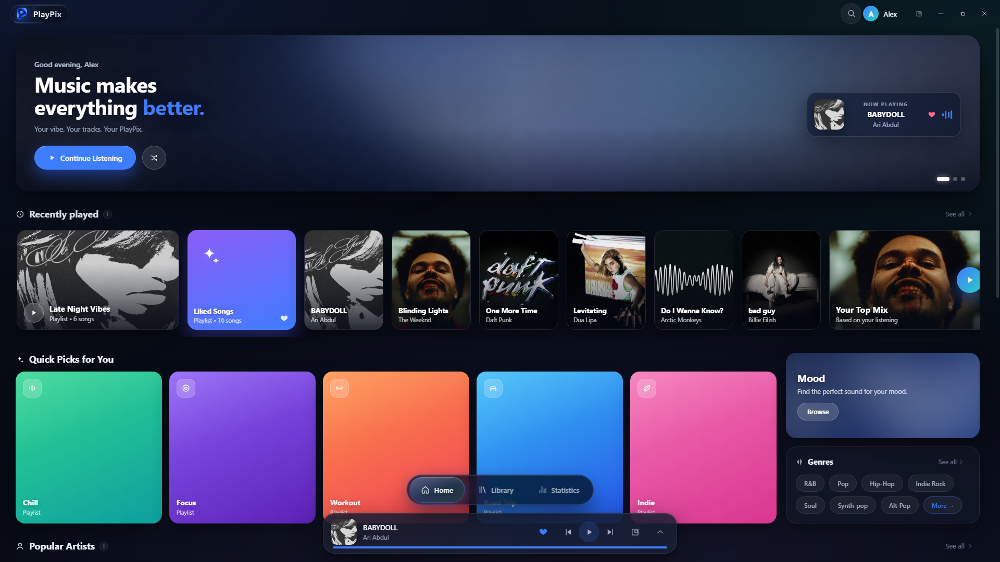
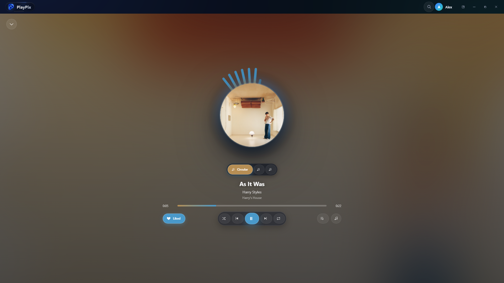
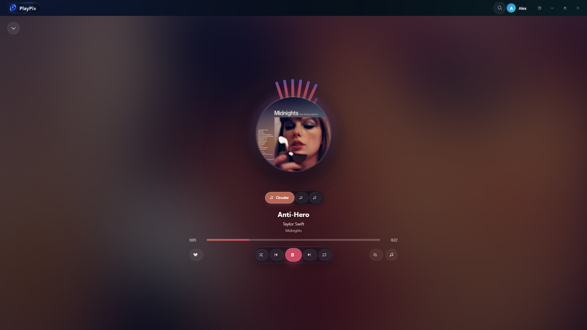
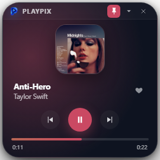
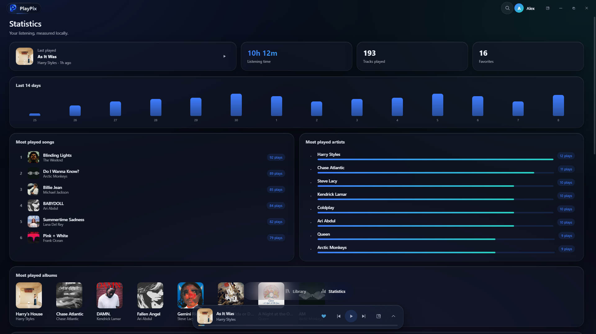
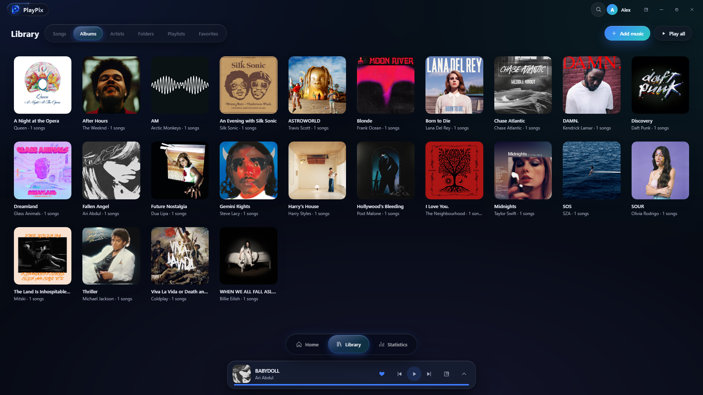
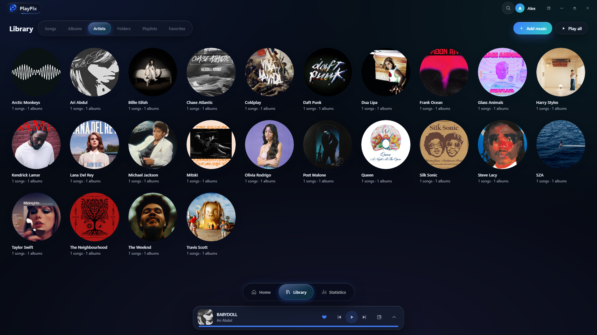
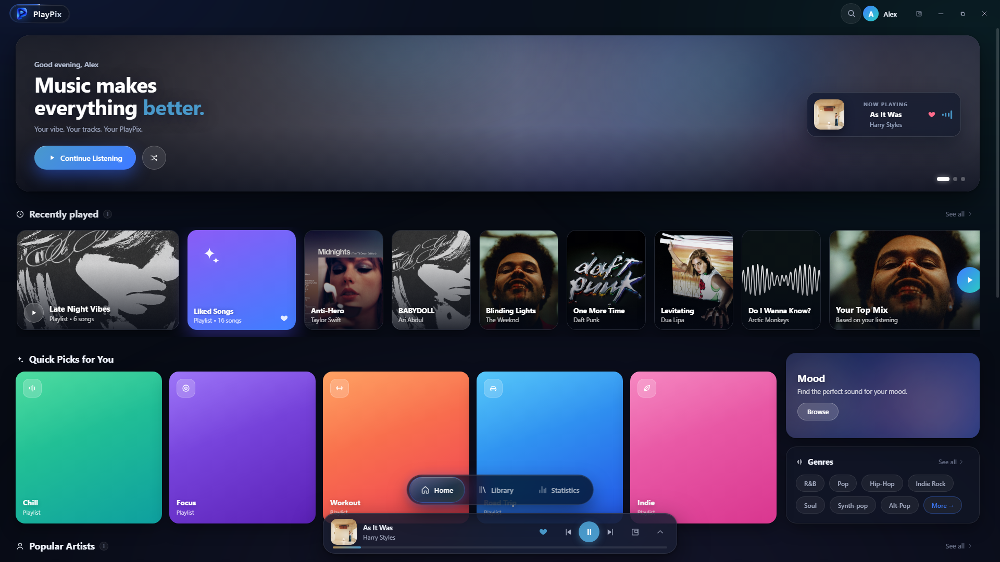
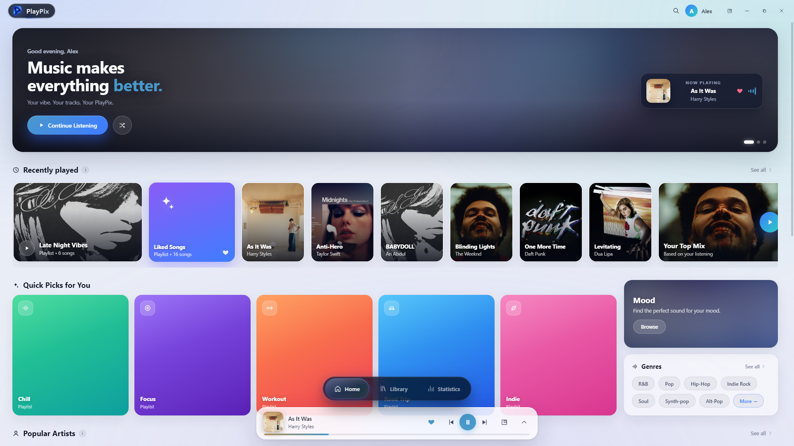

<div align="center">


# PlayPix

**Music, Refined.**  
A modern, high-performance desktop music player for Windows crafted with glassmorphic elegance, instant SQLite search, dynamic album art palettes, and a strictly local-first philosophy.

[](https://microsoft.com)
[](CHANGELOG.md)
[](https://www.typescriptlang.org/)
[](https://react.dev)
[](https://www.electronjs.org/)
[](LICENSE)
[](SECURITY.md)

<br/>



</div>

---

## Overview

Modern streaming platforms have turned music into an algorithmic feed weighed down by subscription paywalls, telemetry, intrusive social hooks, and compressed streams. **PlayPix** restores dignity, ownership, and aesthetic joy to your personal audio archive.

Engineered with Electron, React 18, TypeScript, and an embedded SQLite database with WAL journaling, PlayPix treats lossless music files (FLAC, MP3, WAV, M4A, OGG, AAC) with absolute reverence. It operates 100% offline, indexing tens of thousands of tracks with instantaneous search and zero background telemetry.

---

## Key Features

### 🌟 Floating Glass Dock Navigation
A floating capsule dock suspended above the bottom music bar with `backdrop-blur-xl`, subtle cobalt glow, and liquid travelling indicator pills. Positioned dynamically to guarantee clean separation between navigation and playback transport controls.

### 🎨 Dynamic Album Art Theme
Real-time color extraction from active album covers creates ambient radial gradients across the UI, adapting the listening environment to the visual identity of each artist.

<div align="center">
  
</div>

### 🔮 Radiating Circular Audio Visualizer
The Now Playing view features an expansive circular artwork stage surrounded by a real-time frequency analyser canvas radiating outward to the rhythm of the track.

<div align="center">
  
</div>

### 🪟 Windows Frameless Mini Player
A compact 270×270 px desktop card with rounded glass edges, always-on-top pin toggle, progress scrubber, and essential transport controls—ideal for keeping your music controls floating alongside your workflow.

<div align="center">
  
</div>

### 📊 Private On-Device Listening Statistics
Detailed listening analytics calculated directly from local SQLite database queries with zero cloud telemetry:
- **Top Metrics Row**: Balanced 5-column single-row alignment displaying Last Played with artwork, total listening time, tracks played, and favorites count.
- **14-Day Activity Chart**: Visual daily listening volume distribution.
- **Top Artists & Songs**: Dynamic progress bars and exact play counts.
- **Full Viewport Fitting**: Responsive edge-to-edge layout calibrated for ultra-wide and high-DPI displays.

<div align="center">
  
</div>

### 📚 Curated Music Library
Organize your audio collection effortlessly across multiple views:
- **Albums Grid**: High-density 1:1 artwork cards with artist and release details.
- **Artists**: Circular artist avatars automatically extracted from your library tags.
- **Songs**: Linear tracklist with lightning-fast virtualized 60 FPS scrolling.
- **Folders**: Direct reflection of your local disk folder hierarchy.
- **Smart Playlists**: Automatic 4-cover mosaic collages for Most Played, Recently Added, and Favorites.

<div align="center">
  
  
</div>

### 🌓 Dual-Theme Parity
Flawless support for both **Dark Mode** (Deep Obsidian & Signature Cobalt) and **Light Mode** (Frosted Pearl Glass with vibrant high contrast), featuring instant 350ms cross-fades.

<div align="center">
  
  
</div>

---

## Architecture & Technology Stack

```
PlayPix Architecture
├── Electron 30 Main Process
│   ├── index.ts             # App lifecycle, single-instance lock, window management
│   ├── protocols.ts         # stream:// (range-seek audio), art:// (cached artwork)
│   ├── scan.worker.ts       # Multi-threaded metadata parser (music-metadata)
│   └── services/
│       ├── db.ts            # Embedded SQLite engine with WAL journaling
│       ├── scanner.ts       # Recursive directory scanning & duplicate resolution
│       ├── artwork.ts       # Embedded > sidecar > placeholder fallback
│       └── watcher.ts       # chokidar incremental file system sync
├── Electron Preload
│   └── index.ts             # Context isolation & strongly typed window.playpix bridge
└── React 18 Renderer
    ├── src/pages/           # Home, Library, Detail, Search, Statistics, Onboarding
    ├── src/components/      # Floating NavBar, Visualizer, MiniPlayer, Cards, BulkBar
    ├── src/player/engine.ts # HTML5 AudioContext engine with stream range requests
    ├── src/state/           # React context split for UI, Player, and Library
    └── src/styles/          # Glassmorphic tokens, CSS variables, liquid animations
```

| Layer | Technology | Purpose |
| :--- | :--- | :--- |
| **Runtime** | Electron 30 + Node.js 20 | Desktop shell with native Windows integration |
| **Frontend** | React 18 + TypeScript | Component hierarchy and responsive state management |
| **Styling** | Modern CSS Variables & Glassmorphism | `backdrop-blur-xl`, layered elevation, sub-pixel animations |
| **Database** | SQLite via `better-sqlite3` | Instant queries across 50,000+ tracks with WAL journals |
| **Metadata Parsing** | `music-metadata` in worker threads | Off-main-thread ID3, Vorbis, and MP4 tag extraction |
| **Audio Pipeline** | HTML5 Audio over custom `stream://` | Fast HTTP Range seeking without loading full files into RAM |
| **Bundler** | electron-vite + Vite | Sub-second HMR and optimized production bundles |

---

## Keyboard Shortcuts

| Shortcut | Action |
| :--- | :--- |
| <kbd>Space</kbd> | Play / Pause |
| <kbd>Ctrl</kbd> + <kbd>→</kbd> | Next Track |
| <kbd>Ctrl</kbd> + <kbd>←</kbd> | Previous Track |
| <kbd>Ctrl</kbd> + <kbd>↑</kbd> | Volume Up |
| <kbd>Ctrl</kbd> + <kbd>↓</kbd> | Volume Down |
| <kbd>Ctrl</kbd> + <kbd>F</kbd> | Focus Instant Search |
| <kbd>Ctrl</kbd> + <kbd>1</kbd> | Navigate to Home |
| <kbd>Ctrl</kbd> + <kbd>2</kbd> | Navigate to Library |
| <kbd>Ctrl</kbd> + <kbd>3</kbd> | Navigate to Statistics |
| <kbd>Esc</kbd> | Close Overlays / Dialogs / Now Playing |

---

## Getting Started

### Prerequisites
- [Node.js](https://nodejs.org/) (v20.0.0 or higher recommended)
- [npm](https://www.npmjs.com/) (v9.0.0 or higher)
- Windows 10 or 11 (64-bit)

### Installation & Development

```bash
# 1. Clone the repository
git clone https://github.com/your-username/playpix.git
cd playpix

# 2. Install dependencies
npm install

# 3. Rebuild native modules (better-sqlite3) against Electron
npm run rebuild

# 4. Launch development server with hot-module reload
npm run dev
```

### Production Build

```bash
# Typecheck TypeScript across all processes
npm run typecheck

# Build and bundle renderer and main processes
npm run build

# Package standalone Windows executable & NSIS installer
npm run dist:win
```

Packaged distribution outputs will be generated in `dist/` and `release/`.

---

## Brand Guidelines & Documentation

A comprehensive **PlayPix Official Brand Book & Visual Identity System** (31-page agency guide) is included in this repository:

* 📄 **Brand Book PDF**: [`docs/PlayPix-Official-Brand-Book.pdf`](docs/PlayPix-Official-Brand-Book.pdf)
* 🎨 **Design System Tokens**: [`docs/DESIGN_SYSTEM.md`](docs/DESIGN_SYSTEM.md)
* 🎬 **Launch Video Storyboard**: [`docs/STORYBOARD.md`](docs/STORYBOARD.md)

---

## Privacy & Local-First Commitment

1. **Zero Telemetry**: PlayPix never phones home, collects metrics, sends crash telemetry, or tracks your listening habits.
2. **Offline Always**: No mandatory sign-in, account creation, or cloud sync. All databases reside strictly on your local machine (`%APPDATA%\PlayPix`).
3. **Safe File Handling**: PlayPix treats your audio files with care. Library scans and queries never modify or relocate your music files without explicit user action and automatic backups.

---

## License

This project is licensed under the MIT License - see the [LICENSE](LICENSE) file for details.

---

<div align="center">
<sub>Crafted with passion for music lovers and audio collectors. © 2026 PlayPix Contributors.</sub>
</div>
